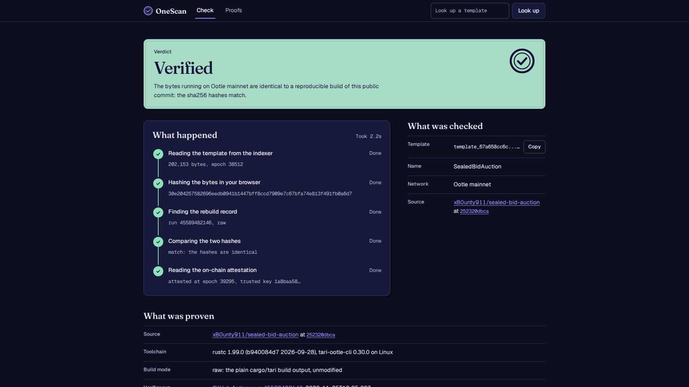
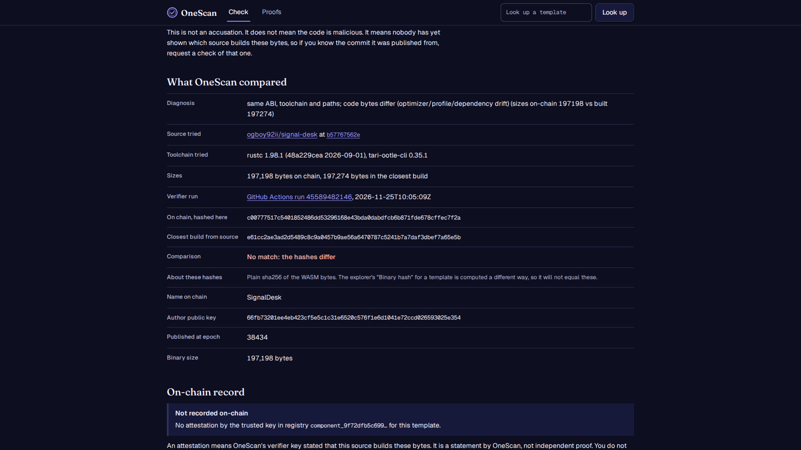
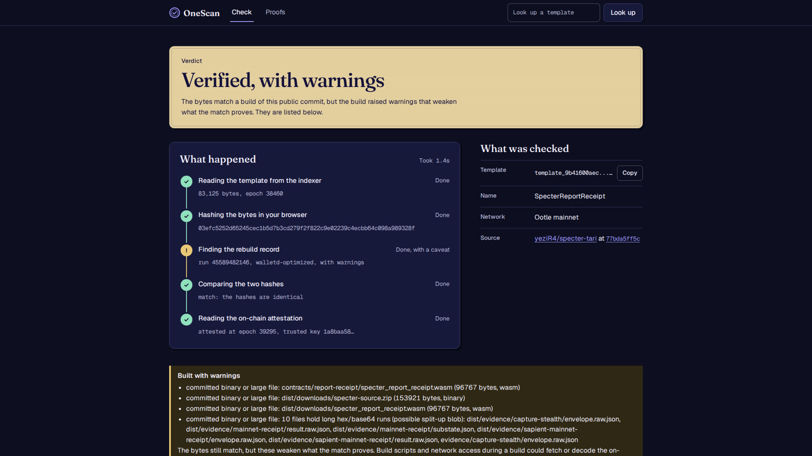
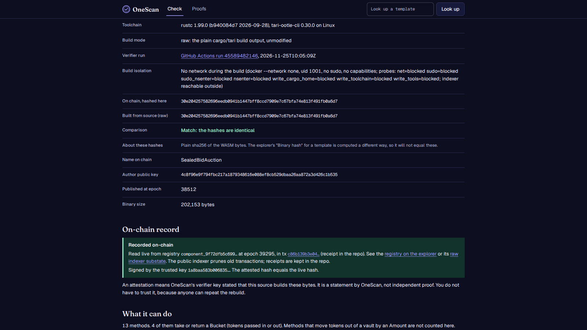
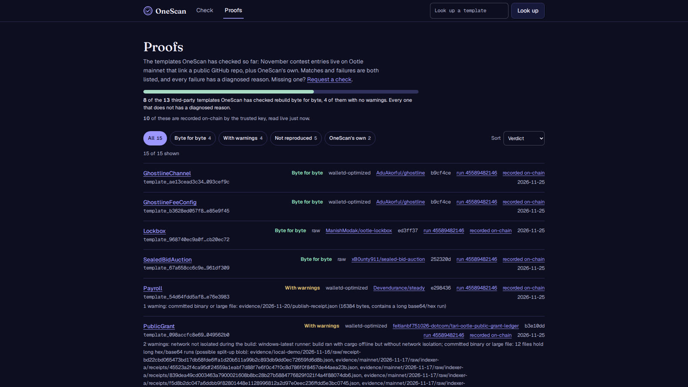
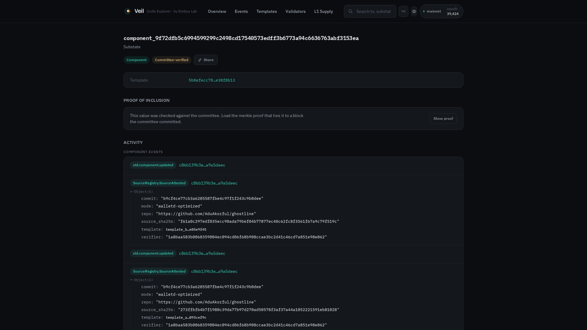
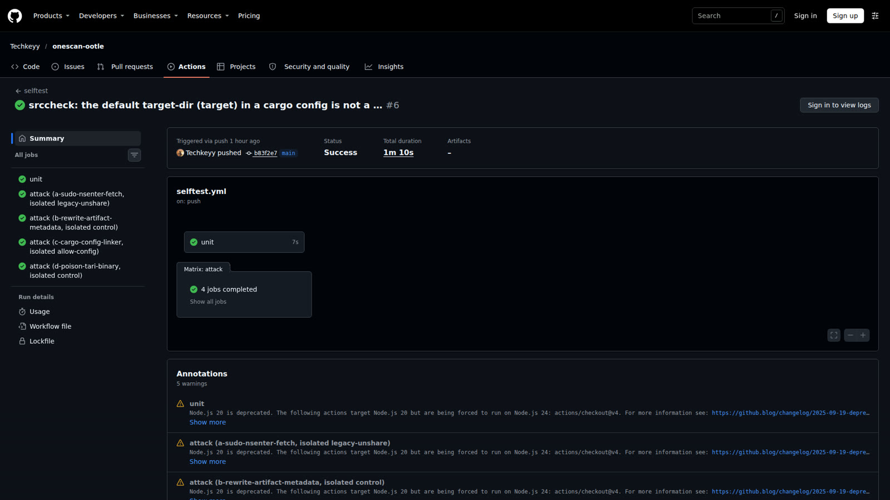

# OneScan for Ootle

Paste a Tari Ootle template address and see, with proof, whether a public commit rebuilds the exact WASM running on mainnet.

**[Live site](https://techkeyy.github.io/onescan-ootle/)** · **[Proofs board](https://techkeyy.github.io/onescan-ootle/board.html)** · **[Registry on chain](https://explorer.tari.mw/substate/component_9f72dfb5c6994599299c2498cd17540573edff3b6773a94c6636763abf3153ea)** · [Verifier runs](https://github.com/Techkeyy/onescan-ootle/actions/workflows/verify.yml) · [Attack tests](https://github.com/Techkeyy/onescan-ootle/actions/runs/45589478456) · [Transaction receipts](evidence/mainnet/)

On Ootle, every smart contract is a template: compiled WebAssembly, published on chain. Nobody can read that. Anyone can put a GitHub link next to a template, and nothing on chain says whether the link is the code that runs. OneScan is for people about to sign a transaction against a template, and for builders who want to prove their source is real.

> *"This template says its source is on GitHub. Is that really what I am about to sign against?"*



## Why this exists

A source link is a claim, not proof. The repo can hold an older version, the template can live in a different folder, or the link can point at a different program entirely. Explorers show the template's binary and its ABI. They cannot tell you which source produced it.

```
   github.com/builder/template @ commit           Ootle mainnet
              |                                         |
   OneScan rebuilds it in public            OneScan reads the template bytes
   (locked container, no network)            from the indexer, in your browser
              |                                         |
              +------------> sha256 == sha256 ? <-------+
                                    |
                 yes: VERIFIED, recorded in OneScan's SourceRegistry on chain
                 no:  NOT REPRODUCED, with the reason
```

Ethereum has had this for years (Etherscan and Sourcify source verification). Ootle had nothing. OneScan also works for templates that are already deployed, because it reproduces the optimization step the Tari wallet applies at publish.

## What it does

1. **Reads the chain.** Your browser fetches the template substate from the public Ootle indexer (`indexer-a.ootle.tari.com`) and decodes the WASM inside it.
2. **Hashes it in your browser.** sha256 with `crypto.subtle`. No server tells you the hash.
3. **Rebuilds the claimed source in public.** A GitHub Actions run clones the repo at the named commit and builds it with the recorded toolchain and settings. Dependencies are fetched first; on Linux the build then runs in a Docker container with `--network none`, no sudo, all capabilities dropped and read-only tools.
4. **Applies the wallet's optimizer when needed.** `tari_walletd` runs wasm-opt 0.116.1 with fixed options when it publishes a template. The verifier reproduces that step with a small harness (`gate/walletd-opt`) and compares both the raw and the optimized build.
5. **Compares the bytes in a trusted step.** A separate job that never runs repo code fetches the on-chain bytes itself and takes only the built `.wasm` from the build. The two sha256 values must be equal. There is no partial credit.
6. **Attests on chain.** Matches are written to OneScan's `SourceRegistry` component on Ootle mainnet, signed by the OneScan verifier key. The site reads that component live and counts an entry only if the trusted key signed it and its hash equals the live bytes.

Every result page shows the steps as they happen, the commit, toolchain, build mode, isolation, the run, both hashes, the on-chain record, the methods decoded from the template's own `tari_tdef` ABI (flagging ones that take or return tokens), a link and badge, and a command to repeat the rebuild yourself.

| Verified | Not reproduced, with the reason |
|---|---|
|  |  |
| **Verified, with warnings** | **What was proven** |
|  |  |

## Current results

From the latest full verifier run under the hardened pipeline ([run 45589482146](https://github.com/Techkeyy/onescan-ootle/actions/runs/45589482146), 2026-11-25):

| | Count |
|---|---|
| Third-party templates checked | 13 |
| Rebuild byte for byte | 8 (4 clean, 4 with warnings) |
| Not reproduced, each with a diagnosed reason | 5 |
| Templates attested on chain by the trusted key | 10 (the 8 matches, plus OneScan's own two) |

| Template | Result |
|---|---|
| Sealed Bids, Lockbox, Ghostline Channel, Ghostline Fee Config | Verified, clean |
| Payroll (Steady), Semvi, Specter Report Receipt, Public Grant | Verified, with warnings (committed receipt or binary files, build scripts, or a Windows build that cannot be isolated) |
| Signal Desk, Signal Forecasts, Signal Follows, Cursed Pumpkin | Not reproduced: same ABI, toolchain and paths, but the code bytes differ (the published commit or `Cargo.lock` is likely not the public one) |
| MoonMail | Not reproduced: the `tari_tdef` ABI section differs, so the public commit is not what was published |

OneScan's own templates (Ootle Split and the SourceRegistry) are on the board but not counted. **OneScan verified its own registry contract**: it rebuilds from this repo, byte for byte, through the wallet's optimizer.

**How the templates were chosen:** November contest entries that are live on Ootle mainnet and link a public GitHub repo. This is not every template on Ootle. Templates without public source cannot match anything and are not listed. To add one, [request a check](#request-a-check).



## Mainnet addresses

| What | Value |
|---|---|
| SourceRegistry template | `5b0efecc709ce6885b69738ce8f774f086ef0c6cb7b2a58920f8bab3e38f8b13` |
| Registry component | `component_9f72dfb5c6994599299c2498cd17540573edff3b6773a94c6636763abf3153ea` ([explorer, with every SourceAttested event](https://explorer.tari.mw/substate/component_9f72dfb5c6994599299c2498cd17540573edff3b6773a94c6636763abf3153ea), [raw indexer substate](https://indexer-a.ootle.tari.com/substates/component_9f72dfb5c6994599299c2498cd17540573edff3b6773a94c6636763abf3153ea?local_search_only=false)) |
| Trusted verifier key | `1a8baa583b0068359004ec094cd06f68b908ccae3bc2d41c46cd7a851e98e862` |
| Publish tx | [`eda11d8d940fe6080bf3d6f1dee2b88a2fb4af99f1f663589f30b672819e1004`](evidence/mainnet/tx-eda11d8d940fe6080bf3d6f1dee2b88a2fb4af99f1f663589f30b672819e1004.json) |
| Instantiate tx | [`485a86626c42397ac09a197d5cc55439cdadeb61be965fbad5d6eb0f6e23f2b9`](evidence/mainnet/tx-485a86626c42397ac09a197d5cc55439cdadeb61be965fbad5d6eb0f6e23f2b9.json) |
| Attest tx (10 `SourceAttested` events) | [`c86b139b3e04f4eaa9d310020802397c9ba53c41ad5c04f490f3bd30a9a5deec`](evidence/mainnet/tx-c86b139b3e04f4eaa9d310020802397c9ba53c41ad5c04f490f3bd30a9a5deec.json) |

The public indexer prunes old transactions, so the wallet receipts are kept in this repo. The registry component stays readable on the explorer, and that is the proof the site reads live.



A note on hashes: OneScan shows the plain sha256 of the WASM bytes. The explorer's "Binary hash" for a template is computed a different way, so the two are not equal. `dist/onescan_registry.wasm` is the build before the wallet's wasm-opt pass, so its hash (`a5d24edf…`) differs from the on-chain bytes (`fa009b0a…`); the self-check compares the optimized output.

## How I tried to break it

A cold review found ways a malicious repo could fake VERIFIED. I fixed each one and added an attack fixture that must fail. The [selftest workflow](https://github.com/Techkeyy/onescan-ootle/actions/runs/45589478456) runs every attack twice: with the defence on (blocked) and with it off (the attack succeeds, which proves it was real).

| Attack | Defence | Result |
|---|---|---|
| A. A `build.rs` that uses passwordless sudo (`sudo nsenter`) to get the network back and download the on-chain bytes | Build runs in Docker with `--network none`, no sudo in the image, `--cap-drop ALL`, `no-new-privileges`; probes are logged and the build is refused if any is open | Blocked; fakes a match with the old namespace sandbox |
| B. A build that rewrites `onchain.json` and the source-check results in its own output | The trusted record job re-fetches the chain bytes and re-runs the source checks itself; it takes only the candidate `.wasm` from the build | Blocked; the forged metadata is ignored |
| C. A `.cargo/config.toml` linker script that assembles the on-chain bytes from 40 small decimal-array files | Repo cargo configs that set a linker, rustc wrapper, runner, source replacement or link flags are a hard failure; split data is flagged | Rejected before `cargo` runs |
| D. A build that overwrites the `tari` CLI so later checks use a poisoned tool | No tool cache; the CLI is installed before any repo code runs and mounted read-only; its hash is checked before and after | Blocked |

Other inputs:

| Input | Result |
|---|---|
| A failed attempt for a template that already has a match | Kept as an attempt; it never replaces the match |
| A verify request from someone without write access | Waits for a maintainer to add the `verify-approved` label |
| An attestation from a key other than OneScan's | Ignored by the site |
| An attestation whose hash no longer equals the live bytes | Not counted; the result page says so |
| Repo or run links in a record that are not GitHub URLs | Shown as text, never as links |
| A component address pasted as a template | "No template at this address", no verdict |

**A green verdict needs live bytes, a public build with the same sha256, isolation, and no warnings.**



## Trust model and limits

- **Verified source is not an audit.** A match says which public commit built the bytes. It does not say the code is safe.
- **An attestation is a statement by the OneScan verifier key.** Anyone can call `attest` on the registry; the site ignores entries from other keys. You do not have to trust the key: the rebuild is public and anyone can repeat it.
- **Windows builds cannot be isolated.** Some templates were built on Windows and only reproduce on a Windows runner. Those builds run with cargo offline but without a container, and the result carries a warning.
- **Warnings weaken a match.** A result is "with warnings" when the build was not isolated, or the source checks found build scripts, proc macros, `include_bytes!`, committed binaries or long encoded data, or `[patch]` and git dependencies. A build script that embeds data committed in its own repo can still match, so it is always shown with a warning, never clean.
- **Method flags are hints.** They come from argument types in the ABI. The ABI does not say who may call a method.
- **A miss is not an accusation.** It means nobody has yet shown which source builds those bytes.

## Re-verify it yourself

**With GitHub Actions (your account):** fork this repo, enable Actions, run the `tools.yml` workflow once (it builds the wasm-opt harness as a release asset), then run the command shown on any result page:

```bash
gh workflow run verify.yml -R <you>/onescan-ootle \
  -f template=template_67a658cc6c9e1c3564871e378f0a60d0b4f8682222460c34aa852caa961df309 \
  -f repo=https://github.com/xB0unty911/sealed-bid-auction -f commit=252320dbca6eb86b43a7d511b3ae72285c04ebd5
```

The run reads the template from the indexer itself and writes the comparison to its log and to `registry/` in your fork.

**Locally:**

1. Fetch the on-chain bytes: `python -I gate/read_template.py <template hex> onchain.wasm`, then `sha256sum onchain.wasm`.
2. Clone the source at the recorded commit and build it with the recorded toolchain and flags (each record in `registry/<template>.json` has a `recipe`), for example `RUSTFLAGS="--remap-path-prefix=$CARGO_HOME=/build/.cargo" cargo build --target wasm32-unknown-unknown --release`.
3. For `walletd-optimized` records, run the output through the optimizer: `cargo build --release` in `gate/walletd-opt`, then `walletd-opt in.wasm out.wasm`.
4. Compare: the sha256 of your build must equal the on-chain hash.

## Request a check

Check your template on the site and use the form on the result page, or open a [verify request issue](https://github.com/Techkeyy/onescan-ootle/issues/new?template=verify-request.yml&labels=verify-request) with the template address, repo and commit. A public Actions run rebuilds it and posts the result on the issue.

## Add the badge

Every checked template gets a badge that opens its live check. Replace `<hex>` with your 64-hex template address (the result page has a copy button):

```markdown
[](https://techkeyy.github.io/onescan-ootle/?t=<hex>)
```

[](https://techkeyy.github.io/onescan-ootle/?t=5b0efecc709ce6885b69738ce8f774f086ef0c6cb7b2a58920f8bab3e38f8b13)

The badge reads "source verified", "verified, with warnings" or "source not reproduced".

## Tests

| Suite | What it proves | Where |
|---|---|---|
| Registry engine tests (4) | Attest and read back, several verifiers per template, invalid fields rejected, per-template cap | [`registry-template/tests`](registry-template/tests/registry.rs), output in [`evidence/registry-tests.txt`](evidence/registry-tests.txt) |
| Verifier unit tests | Cargo config parsing and the attempt merge rules | [`tests/test_verifier.py`](tests/test_verifier.py) |
| Attack selftest (4 attacks) | Each attack is blocked, and succeeds with its defence off | [`tests/attacks`](tests/attacks), [`selftest.yml`](.github/workflows/selftest.yml) |
| Self-verification | OneScan's registry contract rebuilds byte for byte | [`registry/5b0efecc…json`](registry/5b0efecc709ce6885b69738ce8f774f086ef0c6cb7b2a58920f8bab3e38f8b13.json) |

## Architecture

| Path | Job |
|---|---|
| `web/` | Static site: lookup with live steps, chain read, in-browser hashing, live registry read, board, badge JSON (`web/build.py`) |
| `verifier/` | Plans recipes, builds in isolation (`build.sh`, `build-image.sh`), checks source (`srccheck.py`), records results in a trusted job (`record.py`, `registry.py`) |
| `registry/` | Best result per template, plus every attempt under `registry/attempts/` |
| `registry-template/` | The SourceRegistry Ootle template (Rust, `tari_template_lib` 0.41.0) |
| `gate/` | Indexer reader (`read_template.py`), the walletd wasm-opt harness, and the day-one feasibility results |
| `scripts/attest.mjs`, `manifests/` | Build and submit the create and attest transactions |
| `targets/` | Batch recipe lists for verifier runs |
| `tests/` | Attack fixtures, the attack runner, unit tests |
| `evidence/` | Mainnet transaction receipts and engine test output |
| `docs/` | How the registry was published ([`PUBLISH.md`](docs/PUBLISH.md)) and screenshots |
| `.github/workflows/` | `verify.yml`, `verify-request.yml`, `selftest.yml`, `registry-ci.yml`, `pages.yml`, `tools.yml` |

OneScan is an independent tool. It is not affiliated with Tari Labs.

## License

[MIT](LICENSE)
