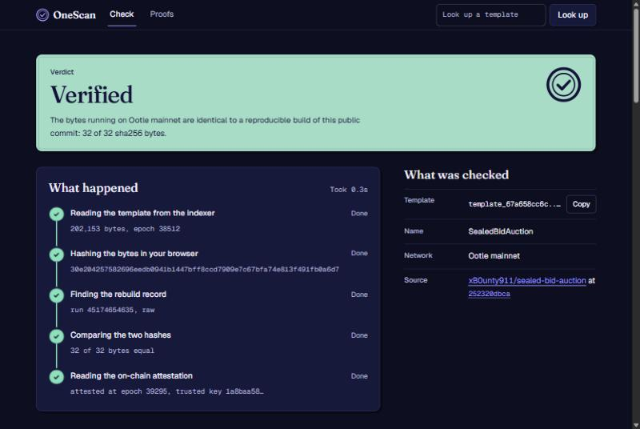

# OneScan for Ootle

Paste an Ootle template address and see whether a public commit rebuilds the exact WASM running on mainnet.

**[Live site](https://techkeyy.github.io/onescan-ootle/)** · **[Proofs board](https://techkeyy.github.io/onescan-ootle/board.html)** · **[Registry on chain](https://explorer.tari.mw/substate/component_9f72dfb5c6994599299c2498cd17540573edff3b6773a94c6636763abf3153ea)** · [Verifier runs](https://github.com/Techkeyy/onescan-ootle/actions/workflows/verify.yml) · [Transaction receipts](evidence/mainnet/)

On Ootle, a template is compiled WASM. Anyone can put a GitHub link next to it, and nothing on chain says whether that link is the code that runs. OneScan is for people about to call a template, and for builders who want to show their source is real.

> *"This template says its source is on GitHub. Is that really what I am about to sign against?"*



## How a check works

1. **Reads the chain.** Your browser fetches the template substate from the public Ootle indexer (`indexer-a.ootle.tari.com`) and decodes the WASM inside it.
2. **Hashes it in your browser.** sha256 with `crypto.subtle`. No server tells you the hash.
3. **Rebuilds the claimed source in public.** A GitHub Actions run clones the repo at the named commit and builds it with a pinned Rust toolchain and recorded settings (builder, crate directory, `CARGO_HOME` remap). Dependencies are fetched first; on Linux the build itself then runs in a network namespace with no network, and the on-chain binary is not on disk while it runs.
4. **Applies the wallet's optimizer when needed.** `tari_walletd` runs wasm-opt (0.116.1, its exact options) on a template when publishing it. The verifier reproduces that step with a small harness (`gate/walletd-opt`) and compares both the raw and the optimized build.
5. **Compares the bytes.** The build's sha256 must equal the on-chain sha256. There is no partial credit.
6. **Attests on chain.** Matches are written to OneScan's `SourceRegistry` component on Ootle mainnet, signed by the OneScan verifier key. The site reads that component live and counts an entry only if the trusted key signed it and its hash equals the live bytes.

Every result page shows the commit, toolchain, build mode, the run, both hashes, the on-chain record, the methods decoded from the template's own `tari_tdef` ABI, and a command to repeat the rebuild yourself.

## Current results

As of 2026-11-25 (last verifier run 2026-11-23, [run 45174654635](https://github.com/Techkeyy/onescan-ootle/actions/runs/45174654635)):

| | Count |
|---|---|
| Third-party templates checked | 13 |
| Rebuild byte for byte | 8 (5 clean, 3 with warnings) |
| Not reproduced, each with a diagnosed reason | 5 |
| Templates attested on chain by the trusted key | 10 (the 8 matches, plus OneScan's own two) |

OneScan's own templates (Ootle Split and the SourceRegistry) are listed on the board but not counted in these totals. The registry rebuilds from this repo ([run 45205039012](https://github.com/Techkeyy/onescan-ootle/actions/runs/45205039012)).

**How the templates were chosen:** November contest entries that are live on Ootle mainnet and link a public GitHub repo, as found in the contest threads. This is not every template on Ootle. Templates without public source cannot match anything and are not listed. To add one, [request a check](#request-a-check).

The live numbers are on the [board](https://techkeyy.github.io/onescan-ootle/board.html), built from [`registry/`](registry/).

## Mainnet addresses

| What | Value |
|---|---|
| SourceRegistry template | `5b0efecc709ce6885b69738ce8f774f086ef0c6cb7b2a58920f8bab3e38f8b13` ([explorer](https://explorer.tari.mw/template/5b0efecc709ce6885b69738ce8f774f086ef0c6cb7b2a58920f8bab3e38f8b13)) |
| Registry component | `component_9f72dfb5c6994599299c2498cd17540573edff3b6773a94c6636763abf3153ea` ([explorer, with every SourceAttested event](https://explorer.tari.mw/substate/component_9f72dfb5c6994599299c2498cd17540573edff3b6773a94c6636763abf3153ea), [raw indexer substate](https://indexer-a.ootle.tari.com/substates/component_9f72dfb5c6994599299c2498cd17540573edff3b6773a94c6636763abf3153ea?local_search_only=false)) |
| Trusted verifier key | `1a8baa583b0068359004ec094cd06f68b908ccae3bc2d41c46cd7a851e98e862` |
| Publish tx | [`eda11d8d940fe6080bf3d6f1dee2b88a2fb4af99f1f663589f30b672819e1004`](evidence/mainnet/tx-eda11d8d940fe6080bf3d6f1dee2b88a2fb4af99f1f663589f30b672819e1004.json) |
| Instantiate tx | [`485a86626c42397ac09a197d5cc55439cdadeb61be965fbad5d6eb0f6e23f2b9`](evidence/mainnet/tx-485a86626c42397ac09a197d5cc55439cdadeb61be965fbad5d6eb0f6e23f2b9.json) |
| Attest tx (10 `SourceAttested` events) | [`c86b139b3e04f4eaa9d310020802397c9ba53c41ad5c04f490f3bd30a9a5deec`](evidence/mainnet/tx-c86b139b3e04f4eaa9d310020802397c9ba53c41ad5c04f490f3bd30a9a5deec.json) |

The public indexer prunes old transactions; receipts are kept in the repo. The registry component itself stays readable, and that is the proof the site uses.

A note on hashes: OneScan shows the plain sha256 of the WASM bytes. The explorer's "Binary hash" for a template is computed a different way, so the two will not be equal. Also, `dist/onescan_registry.wasm` is the build before the wallet's wasm-opt pass, so its hash (`a5d24edf…`) differs from the on-chain bytes (`fa009b0a…`); the self-check compares the walletd-optimized output.

## Trust model and limits

- **Verified source is not an audit.** A match says which public commit built the bytes. It does not say the code is safe.
- **An attestation is a statement by the OneScan verifier key.** Anyone can call `attest` on the registry; the site ignores entries from other keys. You do not have to trust the key: the rebuild is public and anyone can repeat it.
- **Windows builds are not network-isolated.** Some templates were built on Windows and can only be reproduced on a Windows runner. Those builds run with cargo offline but without a network namespace, and the result carries a warning.
- **Warnings weaken a match.** A result is "with warnings" when the build was not isolated, or static source checks found build scripts (`build.rs`), `include_bytes!`, committed binaries, or `[patch]`/git dependencies. Those could fetch or embed the on-chain binary instead of compiling it. The bytes still match; the warning tells you how much the match proves.
- **Method flags are hints.** They come from argument types and names in the ABI. The ABI does not say who may call a method.
- **A miss is not an accusation.** It means nobody has yet shown which source builds those bytes, usually because the published commit or `Cargo.lock` differs from the public one.

## How I tried to break it

| Input | Result |
|---|---|
| A malicious `build.rs` that downloads the on-chain binary instead of compiling | Fails under isolation; fakes a match only when isolation is off ([selftest run 45173613072](https://github.com/Techkeyy/onescan-ootle/actions/runs/45173613072)) |
| A repo that commits the published `.wasm` | Committed `*.wasm` files are deleted before the build |
| Source that is close but not the published commit (Signal Desk) | Not reproduced, with a diagnosis: same ABI and toolchain, code bytes differ |
| Source at the wrong commit or directory (MoonMail) | Not reproduced: the `tari_tdef` ABI section differs |
| An attestation from a key other than OneScan's | Ignored by the site |
| An attestation whose hash no longer equals the live bytes | Not counted; the result page says the attested hash differs |
| A component or resource address pasted as a template | "No template at this address", no verdict |

**A green verdict needs live bytes, a public build with the same sha256, and no warnings.**

## Re-verify it yourself

**With GitHub Actions (same workflow, your account):** fork this repo, enable Actions, then run the command shown on any result page, for example:

```bash
gh workflow run verify.yml -R <you>/onescan-ootle \
  -f template=template_67a658cc6c9e1c3564871e378f0a60d0b4f8682222460c34aa852caa961df309 \
  -f repo=https://github.com/xB0unty911/sealed-bid-auction -f commit=252320dbca6eb86b43a7d511b3ae72285c04ebd5
```

The run reads the template from the indexer itself and writes the comparison to its log and to `registry/` in your fork. For `walletd-optimized` templates, run the `tools.yml` workflow once in your fork first: it builds the wasm-opt harness as a release asset, and without it the verifier compares raw builds only.

**Locally:**

1. Fetch the on-chain bytes: `python -I gate/read_template.py <template hex> onchain.wasm` and `sha256sum onchain.wasm`.
2. Clone the source at the recorded commit and build it with the recorded toolchain and flags (each record in `registry/<template>.json` has a `recipe`), for example `RUSTFLAGS="--remap-path-prefix=$CARGO_HOME=/build/.cargo" cargo build --target wasm32-unknown-unknown --release`.
3. For `walletd-optimized` records, run the output through the walletd optimizer: `cargo build --release` in `gate/walletd-opt`, then `walletd-opt in.wasm out.wasm`.
4. Compare: `sha256sum` of your build must equal the on-chain hash.

## Request a check

Open the site, check your template address, and use the form on the result page, or open a [verify request issue](https://github.com/Techkeyy/onescan-ootle/issues/new?template=verify-request.yml&labels=verify-request) with the template address, repo and commit. A public Actions run rebuilds it and posts the result on the issue.

## Add the badge

Every checked template gets a badge that opens its live check. Replace `<hex>` with your 64-hex template address (the result page has a copy button for this):

```markdown
[](https://techkeyy.github.io/onescan-ootle/?t=<hex>)
```

[](https://techkeyy.github.io/onescan-ootle/?t=5b0efecc709ce6885b69738ce8f774f086ef0c6cb7b2a58920f8bab3e38f8b13)

The badge says "source verified", "verified, with warnings" or "source not reproduced".

## Repo layout

| Path | Job |
|---|---|
| `web/` | Static site: lookup, live chain read, in-browser hashing, board, badge JSON (`web/build.py`) |
| `verifier/` | Plans recipes, builds in isolation, compares hashes, records results |
| `registry/` | One JSON record per checked template, written by verifier runs |
| `registry-template/` | The SourceRegistry Ootle template (Rust) that holds attestations |
| `gate/` | Indexer reader (`read_template.py`) and the walletd wasm-opt harness |
| `scripts/attest.mjs` | Builds the attest manifest from `registry/` |
| `manifests/` | Transaction manifests used to create the registry and attest |
| `targets/` | Batch recipe lists for verifier runs |
| `evidence/` | Mainnet transaction receipts, engine test output, UI screenshots |
| `docs/PUBLISH.md` | How the registry was published and attested |
| `.github/workflows/` | `verify.yml`, `verify-request.yml`, `selftest.yml`, `registry-ci.yml`, `pages.yml`, `tools.yml` |

OneScan is an independent tool. It is not affiliated with Tari Labs.

## License

[MIT](LICENSE)
